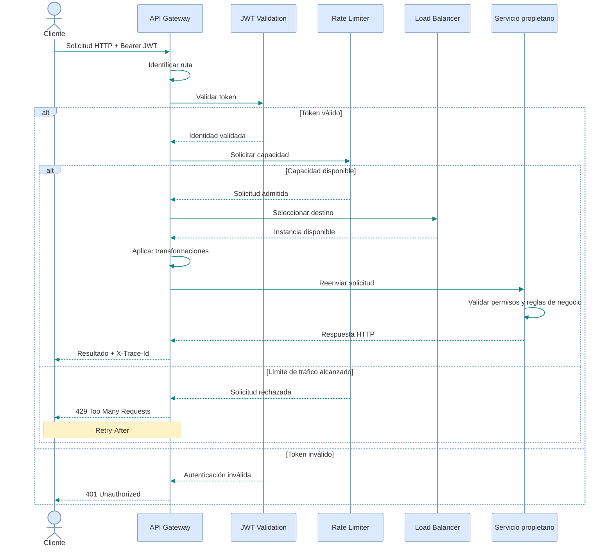
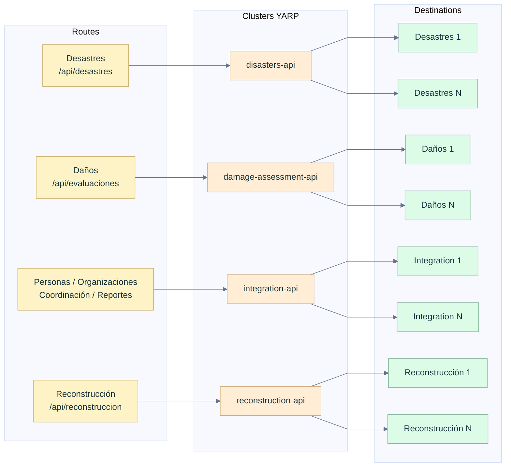
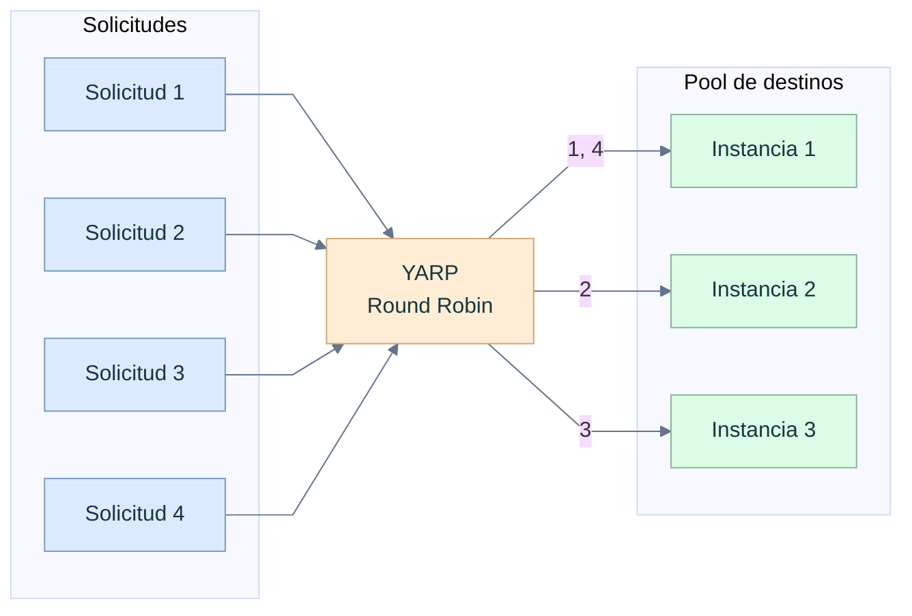
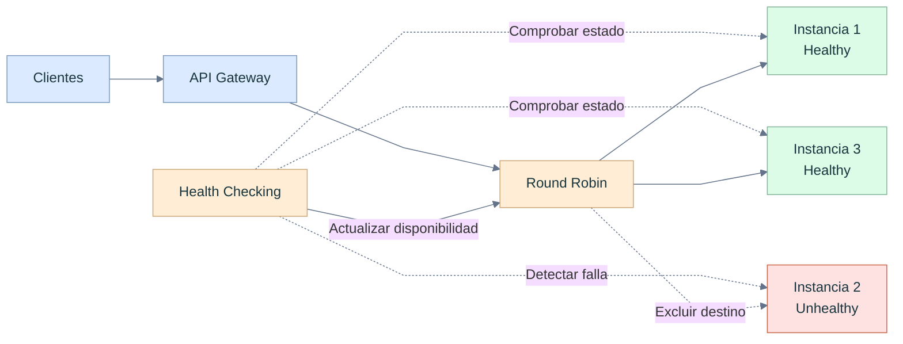
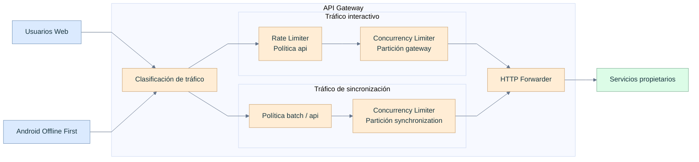
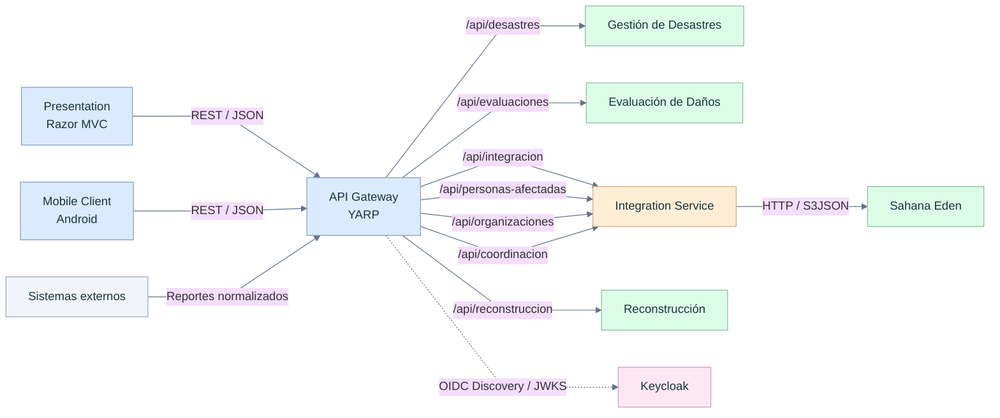
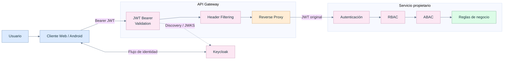
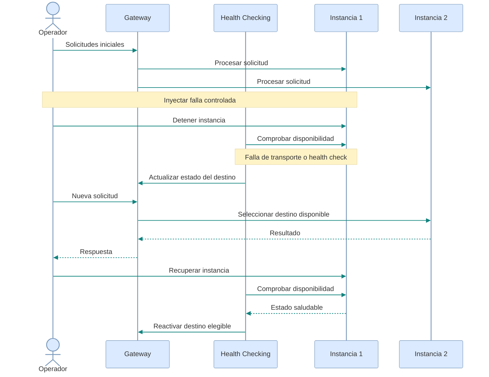

<div align="center">

# RECONECTA

### API Gateway

**De la emergencia a la reconstrucción**

Punto central de acceso e integración de los servicios de la plataforma.


**Pontificia Universidad Javeriana**

Arquitectura de Software · 2026

[Plataforma completa](https://github.com/disaster-management-platform/disaster-platform-infrastructure) ·
[Arquitectura](#arquitectura) ·
[Demostración](#demostración) ·
[Instalación](#instalación-y-ejecución)

</div>

---

## Demostración

<div align="center">

[](https://youtu.be/HVCKoTRAxu8)

[Ver demostración funcional de RECONECTA](https://youtu.be/HVCKoTRAxu8)

</div>

## Descripción

`disaster-api-gateway` implementa el punto central de acceso a los servicios de negocio de RECONECTA mediante YARP (Yet Another Reverse Proxy) sobre ASP.NET Core.

El componente forma parte de la Service-Based Architecture de la plataforma y proporciona mecanismos transversales de enrutamiento, balanceo de carga, validación de tokens, control de tráfico, supervisión de destinos y trazabilidad técnica.

Su incorporación permite desacoplar las aplicaciones cliente de las direcciones, tecnologías y configuraciones internas de los servicios propietarios.

El API Gateway no implementa reglas de negocio, no administra entidades del dominio y no accede directamente a las bases de datos. Su responsabilidad consiste en recibir, controlar y dirigir las solicitudes hacia los componentes correspondientes.

## Contenido

- [Funcionalidades](#funcionalidades)
- [Arquitectura](#arquitectura)
- [Enrutamiento y balanceo de carga](#enrutamiento-y-balanceo-de-carga)
- [Control de tráfico](#control-de-tráfico)
- [Decisiones arquitectónicas](#decisiones-arquitectónicas)
- [Tecnologías y justificación](#tecnologías-y-justificación)
- [Estructura del repositorio](#estructura-del-repositorio)
- [Integración con otros componentes](#integración-con-otros-componentes)
- [Persistencia](#persistencia)
- [Contratos de comunicación](#contratos-de-comunicación)
- [Seguridad](#seguridad)
- [Observabilidad](#observabilidad)
- [Instalación y ejecución](#instalación-y-ejecución)
- [Pruebas](#pruebas)
- [Repositorios relacionados](#repositorios-relacionados)
- [Autores](#autores)

## Funcionalidades

| Funcionalidad | Descripción |
|---|---|
| Punto central de acceso | Proporciona una interfaz común para consumir los servicios de negocio. |
| Enrutamiento | Selecciona el servicio correspondiente según la ruta y el método HTTP. |
| Reverse Proxy | Reenvía solicitudes y respuestas entre clientes y servicios propietarios. |
| Balanceo de carga | Distribuye solicitudes mediante Round Robin cuando existen múltiples destinos configurados. |
| Supervisión de destinos | Utiliza mecanismos activos y pasivos de comprobación de salud. |
| Control de tráfico | Limita solicitudes por ventana temporal y concurrencia. |
| Aislamiento de sincronización | Separa la capacidad asignada al tráfico Batch y Delta del tráfico interactivo. |
| Protección de encabezados | Elimina encabezados que podrían utilizarse para suplantar identidades o modificar solicitudes. |
| Validación JWT | Comprueba tokens Bearer cuando la integración con Keycloak se encuentra configurada. |
| Trazabilidad | Identifica solicitudes mediante Trace ID y registra tiempos, destinos y resultados. |
| Configuración externa | Permite modificar destinos y parámetros sin alterar el código fuente. |
| Contenerización | Proporciona una unidad de despliegue independiente mediante Docker. |

## Arquitectura

### Patrón API Gateway

RECONECTA integra servicios implementados en diferentes tecnologías, principalmente ASP.NET Core y Jakarta EE.

El patrón API Gateway permite establecer una frontera común de comunicación entre los clientes y dichos servicios, ocultando sus direcciones internas y centralizando responsabilidades transversales.

### Vista lógica

```mermaid
%%{init: {"theme":"base","themeVariables":{"background":"#ffffff","lineColor":"#64748b"},"flowchart":{"curve":"linear"}}}%%
flowchart LR

    subgraph CLIENTS["Clientes"]
        direction TB

        W["Presentation
        Razor MVC"]

        M["Android
        Offline First"]

        E["Sistemas externos"]
    end

    subgraph GW["API Gateway — ASP.NET Core / YARP"]

        direction LR

        IN["HTTP Entry Point
        Kestrel"]

        MW["Middleware
        Pipeline"]

        AUTH["JWT Bearer
        Validation"]

        RL["Rate Limiter
        Timeout Policies"]

        RT["Route Matching"]

        TR["Request / Response
        Transforms"]

        HC["Health Checking"]

        LB["Load Balancer
        Round Robin"]

        FW["HTTP Forwarder"]

        IN --> MW

        MW --> AUTH

        AUTH --> RL

        RL --> RT

        RT --> LB

        HC -->|"Estado de destinos"| LB

        LB --> FW

        TR -->|"Transformaciones"| FW

    end

    subgraph SERVICES["Servicios propietarios"]
        direction TB

        D["Gestión de Desastres
        .NET"]

        A["Evaluación de Daños
        Jakarta EE"]

        I["Integration Service
        Jakarta EE"]

        R["Reconstrucción
        .NET"]
    end

    K["Keycloak
    Identity Provider"]

    S["Sahana Eden"]

    W -->|"REST / JSON / JWT"| IN

    M -->|"REST / JSON / JWT"| IN

    E -->|"HTTPS / REST"| IN

    AUTH -.->|"OIDC Discovery / JWKS"| K

    FW --> D & A & I & R

    I -->|"HTTP / S3JSON"| S

    classDef presentation fill:#DBEAFE,stroke:#7B9ABD,color:#19363F;
    classDef logic fill:#DCFCE7,stroke:#86B49A,color:#19363F;
    classDef contract fill:#FEF3C7,stroke:#CBB16F,color:#19363F;
    classDef integration fill:#FFEDD5,stroke:#CEA778,color:#19363F;
    classDef identity fill:#FCE7F3,stroke:#C99AB6,color:#19363F;
    classDef external fill:#F1F5F9,stroke:#94A3B8,color:#19363F;

    class W,M,IN presentation;
    class D,A,I,R,S logic;
    class RT,TR contract;
    class MW,RL,HC,LB,FW integration;
    class AUTH,K identity;
    class E external;
```



El diagrama representa las responsabilidades lógicas del Gateway. El enrutamiento de ASP.NET Core y el pipeline de YARP coordinan su ejecución.

### Componentes internos

| Componente | Responsabilidad |
|---|---|
| Kestrel | Recibir solicitudes HTTP y aplicar límites del servidor. |
| Forwarded Headers Middleware | Interpretar encabezados provenientes de proxies explícitamente confiables. |
| Authentication Middleware | Validar tokens Bearer mediante ASP.NET Core. |
| Rate Limiter | Controlar el volumen y concurrencia de solicitudes. |
| Request Timeouts | Limitar la duración de operaciones según la configuración de cada ruta. |
| Route Matching | Seleccionar rutas según el método HTTP, patrón de URL y restricciones de parámetros. |
| Cluster Configuration | Agrupar destinos correspondientes a un servicio de negocio. |
| Health Checking | Supervisar la disponibilidad de los destinos. |
| Load Balancer | Seleccionar un destino disponible mediante Round Robin. |
| HTTP Forwarder | Reenviar solicitudes y respuestas utilizando YARP. |
| Transforms | Eliminar encabezados no confiables y ajustar respuestas de proxy. |
| Logging Middleware | Registrar identificadores, rutas, destinos, resultados y tiempos de respuesta. |

### Vista de procesos

El Gateway se ejecuta como un proceso ASP.NET Core independiente.

Los componentes de enrutamiento, autenticación, balanceo y reenvío forman parte de la misma unidad ejecutable. No requieren procesos o contenedores independientes.

```mermaid
%%{init: {"theme":"base","themeVariables":{"background":"#ffffff","lineColor":"#64748b"},"flowchart":{"curve":"linear"}}}%%
flowchart LR

    subgraph CLIENT["Procesos cliente"]
        direction TB

        W["ASP.NET Core
        Presentation"]

        M["Android Runtime"]
    end

    subgraph GATEWAY["Proceso ASP.NET Core — API Gateway"]

        direction TB

        K["Kestrel"]

        MP["Middleware Pipeline"]

        Y["YARP Reverse Proxy"]

        LC["Load Balancing"]

        HC["HTTP Forwarder
        Conexiones asíncronas"]

        HP["Health Probes"]

        K --> MP

        MP --> Y

        Y --> LC

        LC --> HC

        HP --> LC

    end

    subgraph BACKEND["Procesos servidores independientes"]

        direction TB

        D["Kestrel
        Desastres"]

        A["WildFly
        Evaluación de Daños"]

        I["WildFly
        Integration Service"]

        R["Kestrel
        Reconstrucción"]
    end

    ID["Proceso Keycloak"]

    W <-->|HTTP(S)| K

    M <-->|HTTP(S)| K

    HC <-->|REST / JSON| D

    HC <-->|REST / JSON| A

    HC <-->|REST / JSON| I

    HC <-->|REST / JSON| R

    MP -.->|"HTTPS / JWKS"| ID

    classDef presentation fill:#DBEAFE,stroke:#7B9ABD,color:#19363F;
    classDef logic fill:#DCFCE7,stroke:#86B49A,color:#19363F;
    classDef integration fill:#FFEDD5,stroke:#CEA778,color:#19363F;
    classDef identity fill:#FCE7F3,stroke:#C99AB6,color:#19363F;

    class W,M,K presentation;
    class D,A,I,R logic;
    class MP,Y,LC,HC,HP integration;
    class ID identity;
```

ASP.NET Core y YARP permiten gestionar múltiples solicitudes concurrentemente mediante operaciones de entrada y salida asíncronas.

El Gateway no mantiene una sesión de negocio por cliente ni requiere almacenar información de dominio entre solicitudes.

### Diagrama de secuencia

#### Procesamiento de una solicitud



La validación JWT del Gateway requiere configurar el proveedor de identidad.

Las solicitudes sin encabezado Authorization permanecen sujetas a las políticas del servicio propietario, incluyendo los contratos explícitamente públicos.

## Enrutamiento y balanceo de carga

### Routes, Clusters y Destinations

La configuración de YARP utiliza tres conceptos principales:

| Concepto | Responsabilidad |
|---|---|
| Route | Define las rutas y métodos HTTP que acepta el Gateway. |
| Cluster | Agrupa las instancias pertenecientes a un servicio lógico. |
| Destination | Representa la dirección de una instancia concreta del servicio. |

Esta separación permite modificar la ubicación o cantidad de instancias sin cambiar los contratos utilizados por los clientes.



La cardinalidad representada corresponde a la capacidad de configurar múltiples destinos por clúster. La cantidad efectiva de réplicas depende del despliegue.

### Clústeres configurados

| Cluster ID | Servicio propietario | Tecnología |
|---|---|---|
| `disasters-api` | Gestión de Desastres | ASP.NET Core |
| `damage-assessment-api` | Evaluación de Daños | Jakarta EE / WildFly |
| `integration-api` | Integration Service | Jakarta EE / WildFly |
| `reconstruction-api` | Reconstrucción | ASP.NET Core |

Los destinos se proporcionan externamente mediante configuración de ejecución.

### Balanceo mediante Round Robin

Los cuatro clústeres utilizan la política `RoundRobin`.

Cuando existen varias instancias disponibles dentro de un clúster, YARP distribuye las solicitudes seleccionando los destinos de manera rotativa.



La política permite incrementar la capacidad de un servicio configurando destinos adicionales, sin modificar las rutas públicas ni los clientes.

El Gateway no implementa por sí mismo un mecanismo de creación automática de contenedores. El aprovisionamiento de instancias corresponde a la infraestructura de despliegue.

### Comprobaciones de salud

YARP utiliza dos mecanismos complementarios:

| Mecanismo | Descripción |
|---|---|
| Active Health Checking | Ejecuta solicitudes periódicas sobre endpoints de diagnóstico. |
| Passive Health Checking | Evalúa fallas de transporte observadas durante el procesamiento de solicitudes reales. |

La configuración utiliza la política de destinos `HealthyAndUnknown`.

Los destinos marcados como no saludables pueden excluirse de la selección, mientras que los saludables o de estado aún desconocido permanecen elegibles según la política configurada.

### Configuración por servicio

| Servicio | Active Health Check | Passive Health Check |
|---|---|---|
| Desastres | No configurado actualmente. | `TransportFailureRate` |
| Evaluación de Daños | `/api/evaluaciones/diagnostico/ready` | `TransportFailureRate` |
| Integration Service | `/api/integracion/diagnostico/ready` | `TransportFailureRate` |
| Reconstrucción | `/api/reconstruccion/health` | `TransportFailureRate` |

Los mecanismos activos configurados utilizan:

| Parámetro | Valor |
|---|---:|
| Política | `ConsecutiveFailures` |
| Intervalo de comprobación | 15 segundos |
| Timeout de comprobación | 3 segundos |
| Reactivación pasiva | 1 segundo |

Estos parámetros corresponden a la configuración publicada, no a una garantía de detección o recuperación dentro de un tiempo determinado.

### Aislamiento de destinos no saludables



Una operación que ya fue enviada a un destino y posteriormente pierde su respuesta no se debe considerar automáticamente fallida ni repetirse indiscriminadamente.

La recuperación de operaciones de negocio depende de los mecanismos de idempotencia implementados por los servicios propietarios.

## Control de tráfico

La plataforma debe poder atender solicitudes interactivas y operaciones masivas de sincronización provenientes de los dispositivos móviles.

El Gateway incorpora mecanismos diferenciados de control de tráfico para limitar el impacto de las operaciones Batch y Delta sobre las consultas y modificaciones interactivas.

### Aislamiento de tráfico



Las rutas Batch y Delta de Desastres y Evaluación de Daños utilizan la partición de concurrencia destinada a sincronización.

### Parámetros de tráfico

| Parámetro | Valor predeterminado |
|---|---:|
| Solicitudes ordinarias por ventana y dirección IP | 1.000 |
| Duración de ventana | 60 segundos |
| Solicitudes concurrentes de tráfico general | 100 |
| Solicitudes concurrentes de sincronización | 2 |
| Presupuesto Batch por ventana | 1.000 operaciones equivalentes |
| Costo máximo configurado por lote | 50 operaciones |
| Solicitudes Batch permitidas por ventana e IP | 20 |
| Solicitudes en espera dentro del limitador | 0 |

El presupuesto Batch se calcula utilizando el costo máximo configurado de un lote, independientemente de su cantidad real de operaciones.

La validación efectiva del número de operaciones corresponde al servicio propietario.

Los límites se mantienen por instancia del Gateway. Replicar el componente incrementa los presupuestos agregados y requiere dimensionar conjuntamente los recursos de los servicios y la base de datos.

### Rechazo controlado de solicitudes

Cuando se alcanza un límite, el Gateway responde:

```http
HTTP/1.1 429 Too Many Requests
Retry-After: 1
Content-Type: application/problem+json
```

El valor de `Retry-After` depende de la información disponible en el limitador.

La aplicación móvil puede conservar las operaciones pendientes y realizar nuevos intentos según su política de backoff.

### Límites de solicitudes

| Parámetro | Valor |
|---|---:|
| Tamaño general máximo de solicitud en Kestrel | 30.000.000 bytes |
| Tamaño total máximo de encabezados | 32.768 bytes |
| Cantidad máxima de encabezados | 100 |
| Timeout de recepción de encabezados | 30 segundos |
| Batch de Desastres | 1.048.576 bytes |
| Batch de Evaluación de Daños | 1.048.576 bytes |
| Operaciones ordinarias de Daños | 262.144 bytes |
| Rutas de evidencias de Daños | 6.356.992 bytes |
| Operaciones de Integration Service | 262.144 bytes |
| Registro de reportes asociados a desastres | 65.536 bytes |

Los límites del Gateway complementan las validaciones específicas de los servicios propietarios.

### Timeouts

| Clúster | Connect Timeout | Activity Timeout |
|---|---:|---:|
| `disasters-api` | 10 s | 120 s |
| `damage-assessment-api` | 3 s | 30 s |
| `integration-api` | 3 s | 25 s |
| `reconstruction-api` | 10 s | 120 s |

Determinadas rutas incorporan adicionalmente timeouts específicos:

- Batch y Delta: 30 segundos.
- Evaluación de Daños: 30 segundos.
- Integration Service: 25 segundos.
- Reportes asociados a desastres: 30 segundos.
- Consulta de coincidencias de desastres: 30 segundos.

El Activity Timeout de YARP controla períodos de inactividad durante el reenvío y no equivale necesariamente a un límite total de ejecución de una operación.

## Decisiones arquitectónicas

| Atributo de calidad | Decisión arquitectónica | Tácticas y mecanismos |
|---|---|---|
| Interoperabilidad | API Gateway como frontera común | HTTP, REST, JSON y rutas explícitas. |
| Disponibilidad | Selección de destinos disponibles | Health checks y balanceo de carga. |
| Escalabilidad | Independencia de destinos | Clústeres y replicación horizontal. |
| Escalabilidad | Control del consumo de recursos | Rate limiting y concurrency limiting. |
| Rendimiento | Comunicación asíncrona | ASP.NET Core, YARP y reutilización de conexiones HTTP. |
| Resiliencia | Contención del tráfico de sincronización | Particiones de concurrencia y límites Batch. |
| Resiliencia | Limitación de tiempos de espera | Connect Timeout, Activity Timeout y Request Timeout. |
| Seguridad | Validación de identidad en la frontera | JWT Bearer, HTTPS y eliminación de encabezados no confiables. |
| Modificabilidad | Enrutamiento declarativo | Routes, Clusters y Destinations configurables. |
| Desplegabilidad | Unidad ejecutable independiente | Docker y configuración externa. |
| Observabilidad | Correlación de solicitudes | Trace ID, rutas, destinos, códigos HTTP y tiempos. |

### Trade-offs

| Decisión | Beneficio | Compromiso |
|---|---|---|
| API Gateway | Centraliza el acceso a los servicios. | Puede convertirse en un punto único de falla si no existe redundancia. |
| Round Robin | Distribución sencilla de solicitudes. | No considera directamente el costo de cada operación. |
| Health Checks | Permiten identificar destinos no saludables. | Introducen tráfico adicional y dependen de los intervalos configurados. |
| Rate Limiting | Protege los recursos disponibles. | Puede rechazar solicitudes legítimas durante picos de demanda. |
| Límites por instancia | Evitan introducir un coordinador distribuido. | El presupuesto agregado cambia al replicar el Gateway. |
| Aislamiento Batch | Reserva capacidad frente a sincronizaciones masivas. | Puede aumentar el tiempo requerido para sincronizar todos los dispositivos. |
| Validación JWT | Rechaza tokens inválidos antes del servicio. | Depende de la disponibilidad de metadatos y claves de firma confiables. |
| Rutas explícitas | Evitan exponer accidentalmente operaciones internas. | Requieren actualizar la configuración al incorporar contratos nuevos. |

## Tecnologías y justificación

### YARP


YARP proporciona los mecanismos de proxy inverso necesarios para implementar el patrón API Gateway dentro de RECONECTA.

Su modelo basado en Routes, Clusters y Destinations permite integrar los servicios .NET y Jakarta EE sin introducir dependencias sobre sus implementaciones internas.

Se seleccionó debido a su integración nativa con ASP.NET Core, su capacidad de configurar mecanismos de balanceo de carga, transformaciones de solicitudes y comprobaciones de salud.

La configuración declarativa favorece la modificabilidad y permite que la topología de despliegue evolucione sin afectar los contratos públicos.

### ASP.NET Core y .NET 10


ASP.NET Core proporciona el entorno de ejecución del Gateway y los mecanismos transversales utilizados para controlar el tráfico HTTP.

Su selección permite reutilizar funcionalidades nativas de middleware, autenticación, configuración, logging, rate limiting y request timeouts.

El procesamiento asíncrono resulta adecuado para un intermediario de comunicación, donde una parte importante del tiempo de ejecución corresponde a la espera de respuestas de otros servicios.

La afinidad tecnológica con los componentes .NET facilita su construcción y despliegue, sin limitar la interoperabilidad con WildFly.

### Kestrel


Kestrel actúa como servidor HTTP del proceso API Gateway.

Permite configurar límites relacionados con tamaños de solicitudes, encabezados y tiempos de recepción.

Estos mecanismos complementan las políticas de control de tráfico y permiten evitar que solicitudes excesivas consuman indiscriminadamente los recursos del componente.

### REST y JSON


REST y JSON constituyen los mecanismos comunes de comunicación entre las aplicaciones cliente y los servicios propietarios.

Su selección permite integrar aplicaciones implementadas en C#, Kotlin, Java y Python sin compartir bibliotecas de ejecución.

El Gateway conserva los contratos de los servicios y no transforma automáticamente sus modelos de negocio.

La traducción semántica entre sistemas heterogéneos corresponde a Integration Service y sus adaptadores.

### Keycloak y JWT Bearer


Keycloak proporciona una fuente común de identidad para los distintos componentes de RECONECTA.

La integración mediante JWT Bearer permite validar los tokens antes del reenvío de solicitudes hacia los servicios propietarios.

Los mecanismos de OpenID Connect Discovery y JWKS permiten obtener la configuración y las claves públicas del proveedor de identidad.

Esta decisión evita establecer un mecanismo de autenticación diferente para cada tecnología y permite conservar una identidad verificable durante el recorrido de la solicitud.

### Docker


Docker permite empaquetar el Gateway y su runtime como una unidad independiente de despliegue.

La imagen utiliza una construcción multietapa que separa el SDK utilizado para compilar del runtime necesario para ejecutar la aplicación.

Esta separación evita instalar herramientas de desarrollo en el entorno de ejecución y facilita la reproducción de las instancias.

La contenerización se alinea con la estrategia general de despliegue administrada por `disaster-platform-infrastructure`.

## Estructura del repositorio

```text
disaster-api-gateway/
│
├── DisasterLocation.Gateway/
│   ├── Properties/
│   │   └── launchSettings.json
│   │
│   ├── wwwroot/
│   │   ├── lib/
│   │   ├── index.html
│   │   ├── app.js
│   │   ├── styles.css
│   │   └── ...
│   │
│   ├── Program.cs
│   ├── appsettings.json
│   └── DisasterLocation.Gateway.csproj
│
├── scripts/
│   ├── test_gateway.py
│   └── test_integration_routes.py
│
├── DisasterLocation.Gateway.sln
├── Dockerfile
├── .dockerignore
├── .gitignore
├── LICENSE
└── README.md
```

| Archivo o directorio | Responsabilidad |
|---|---|
| `Program.cs` | Configuración de middleware, autenticación, limitadores, logging y YARP. |
| `appsettings.json` | Definición de rutas, clústeres, límites y políticas de comunicación. |
| `launchSettings.json` | Configuración de ejecución local. |
| `wwwroot/` | Interfaces estáticas conservadas de etapas anteriores del proyecto. |
| `scripts/` | Pruebas de enrutamiento e integración. |
| `Dockerfile` | Construcción de la imagen ejecutable del Gateway. |
| `.dockerignore` | Exclusión de archivos innecesarios durante la construcción de la imagen. |

La presentación web principal de RECONECTA se encuentra en el repositorio `disaster-platform-presentation`.

Los archivos estáticos conservados en este repositorio no sustituyen dicha aplicación.

## Integración con otros componentes



| Componente | Relación con el Gateway |
|---|---|
| Presentation | Consume los contratos REST de negocio. |
| Android | Consume catálogos, registros, lotes y mecanismos Delta. |
| Gestión de Desastres | Recibe operaciones relacionadas con eventos de desastre. |
| Evaluación de Daños | Recibe operaciones de evaluación, revisión y evidencias. |
| Integration Service | Recibe operaciones de personas, organizaciones, coordinación y reportes externos. |
| Reconstrucción | Recibe operaciones relacionadas con los proyectos. |
| Sahana Eden | Integración indirecta mediante Integration Service. |
| Keycloak | Proporciona identidad y claves públicas para validar tokens. |
| Infrastructure | Configura destinos, certificados, redes y réplicas. |

El Gateway centraliza el acceso externo a las APIs de negocio.

Las comunicaciones internas entre servicios pueden utilizar sus contratos autorizados directamente, según las decisiones establecidas para cada integración.

Sahana Eden conserva sus interfaces nativas independientes y no se expone mediante un clúster directo del Gateway.

## Persistencia

El API Gateway no utiliza bases de datos de negocio.

La información relacionada con desastres, evaluaciones, personas y proyectos es administrada por los servicios propietarios.

El Gateway mantiene únicamente el estado técnico necesario para realizar sus funciones, incluyendo:

- Configuración de rutas y destinos.
- Estado de salud de las instancias.
- Contadores de rate limiting.
- Estado de concurrencia.
- Metadatos y claves públicas de identidad.
- Conexiones HTTP administradas por el proxy.

La persistencia de operaciones, los mecanismos Outbox e Inbox, el control de versiones y la resolución de conflictos pertenecen a los servicios correspondientes.

Esta separación permite replicar el Gateway sin introducir una base de datos de negocio propia.

## Contratos de comunicación

### Gestión de Desastres

| Método | Ruta |
|---|---|
| GET / POST | `/api/desastres` |
| GET / PUT | `/api/desastres/{id}` |
| PUT | `/api/desastres/{id}/fase` |
| GET | `/api/desastres/{id}/historial` |
| GET / POST | `/api/desastres/{id}/reportes` |
| PUT | `/api/desastres/{id}/reportes/{reportId}` |
| PUT | `/api/desastres/{id}/organismos` |
| PUT | `/api/desastres/{id}/geografia` |
| GET | `/api/desastres/{id}/alertas` |
| GET | `/api/desastres/coincidencias` |
| POST | `/api/desastres/batch` |
| GET | `/api/desastres/sync` |
| GET / POST | `/api/tipos-desastre` |
| PUT | `/api/tipos-desastre/{id}/desactivar` |
| GET / POST | `/api/reportes-desastre` |
| GET | `/api/reportes-desastre/{reportId}` |

### Evaluación de Daños

| Método | Ruta |
|---|---|
| GET / POST | `/api/evaluaciones` |
| GET / PUT | `/api/evaluaciones/{id}` |
| PUT | `/api/evaluaciones/{id}/desastre` |
| PUT | `/api/evaluaciones/{id}/estado` |
| GET | `/api/evaluaciones/{id}/historial` |
| POST | `/api/evaluaciones/{id}/revisiones` |
| GET | `/api/evaluaciones/mapa` |
| GET | `/api/evaluaciones/catalogos` |
| POST | `/api/evaluaciones/catalogos/tipos-activo` |
| POST | `/api/evaluaciones/catalogos/categorias-dano` |
| PUT | `/api/evaluaciones/catalogos/tipos-activo/{catalogId}/desactivar` |
| PUT | `/api/evaluaciones/catalogos/categorias-dano/{catalogId}/desactivar` |
| POST | `/api/evaluaciones/batch` |
| GET | `/api/evaluaciones/sync` |
| GET / POST | `/api/evaluaciones/{id}/evidencias` |
| GET | `/api/evaluaciones/{id}/evidencias/{evidenceId}` |
| POST | `/api/evaluaciones/{id}/evidencias/{evidenceId}/confirmar` |
| GET | `/api/evaluaciones/{id}/evidencias/{evidenceId}/descarga` |
| GET | `/api/evaluaciones/openapi` |

### Integration Service

| Método | Ruta |
|---|---|
| GET / POST | `/api/organizaciones` |
| GET | `/api/organizaciones/tipos` |
| GET / PUT | `/api/organizaciones/{id}` |
| GET / POST | `/api/personas-afectadas` |
| GET | `/api/personas-afectadas/resumen` |
| GET / PUT | `/api/personas-afectadas/{id}` |
| POST | `/api/personas-afectadas/{id}/vincular` |
| GET / POST | `/api/coordinacion/tareas` |
| PUT | `/api/coordinacion/tareas/{id}` |
| GET / POST | `/api/coordinacion/actividades` |
| PUT | `/api/coordinacion/actividades/{id}` |
| POST | `/api/integracion/reportes/{category}` |

Las categorías admitidas para reportes externos son:

- `monitoring`
- `gis`
- `hospital`
- `administrative`
- `financial`

### Reconstrucción

| Método | Ruta |
|---|---|
| GET | `/api/reconstruccion/access-mode` |
| GET | `/api/reconstruccion/financiacion` |
| GET | `/api/reconstruccion/workflow` |
| POST | `/api/reconstruccion/propuestas/generar` |
| GET | `/api/reconstruccion/propuestas` |
| GET / POST | `/api/reconstruccion/proyectos` |
| GET | `/api/reconstruccion/proyectos/{id}` |
| GET | `/api/reconstruccion/proyectos/{id}/monitoreo` |
| PUT | `/api/reconstruccion/proyectos/{id}/formalizacion` |
| POST | `/api/reconstruccion/proyectos/{id}/confirmar-formalizacion` |
| PUT | `/api/reconstruccion/proyectos/{id}/presupuesto` |
| POST | `/api/reconstruccion/proyectos/{id}/contrato-firmado` |
| POST | `/api/reconstruccion/proyectos/{id}/actividades/{activityId}/reportes` |
| POST | `/api/reconstruccion/proyectos/{id}/cerrar` |
| GET | `/api/reconstruccion/proyectos/{id}/auditoria` |
| GET | `/api/reconstruccion/proyectos/{id}/linea-tiempo` |
| GET | `/api/reconstruccion/proyectos/{id}/reporte-final` |
| POST | `/api/reconstruccion/proyectos/{id}/adjuntos` |
| GET | `/api/reconstruccion/proyectos/{id}/adjuntos/{attachmentId}` |

### Diagnóstico

| Método | Ruta | Responsabilidad |
|---|---|---|
| GET | `/health` | Estado del proceso Gateway. |
| GET | `/api/reconstruccion/health` | Estado del servicio de Reconstrucción. |
| GET | `/api/reconstruccion/ready` | Readiness de Reconstrucción. |
| GET | `/api/evaluaciones/diagnostico/live` | Liveness de Evaluación de Daños. |
| GET | `/api/evaluaciones/diagnostico/ready` | Readiness de Evaluación de Daños. |

El endpoint interno utilizado por YARP para comprobar Integration Service no se publica automáticamente como ruta externa del Gateway.

Los contratos completos, esquemas JSON y reglas de validación se mantienen en los repositorios propietarios.

## Seguridad

El API Gateway proporciona mecanismos de protección en la frontera de acceso a los servicios.

Su responsabilidad no sustituye la autorización de negocio implementada por cada dominio.

### Validación de identidad



### Responsabilidades de autenticación y autorización

| Componente | Responsabilidad |
|---|---|
| Keycloak | Autenticar identidades y emitir tokens. |
| Aplicaciones cliente | Obtener y propagar credenciales conforme a su flujo de autenticación. |
| API Gateway | Validar tokens Bearer suministrados y reenviar solicitudes autorizables. |
| Servicios propietarios | Aplicar las políticas definitivas de autenticación, RBAC, ABAC y reglas del recurso. |

La integración JWT comprueba:

- Firma del token.
- Issuer.
- Audience.
- Vigencia.
- Configuración confiable del proveedor de identidad.

Cuando la autoridad se encuentra configurada, una solicitud que proporciona un encabezado Authorization inválido recibe `401 Unauthorized` antes de llegar al servicio.

La ausencia del encabezado Authorization no implica una autorización automática. El servicio propietario determina si el contrato requiere autenticación.

### Audiencias

Las audiencias utilizadas por los servicios de RECONECTA se configuran externamente:

| Servicio | Audience |
|---|---|
| Gestión de Desastres | `disasters-api` |
| Evaluación de Daños | `damage-assessment-api` |
| Integration Service | `integration-service` |
| Reconstrucción | `reconstruction-api` |

El identificador del clúster de YARP no tiene que coincidir necesariamente con la audiencia JWT.

### Protección de encabezados

El Gateway elimina encabezados no confiables asociados a:

- Identidades de usuario.
- Identificadores de organizaciones.
- Certificados de cliente.
- Direcciones originales suministradas por clientes.
- Sobrescritura de métodos HTTP.

Entre los encabezados filtrados se encuentran:

```text
Forwarded
X-Original-For
X-Original-Proto
X-Original-Host
X-Original-Prefix
X-Actor
X-User
X-User-Id
X-Organization-Id
X-Authenticated-User
X-Client-Cert
X-Forwarded-Client-Cert
X-Http-Method-Override
X-Http-Method
X-Method-Override
```

Esto evita que los clientes establezcan identidades artificiales mediante encabezados que no forman parte de los mecanismos autorizados.

También se eliminan determinados encabezados de respuesta que revelan información sobre las tecnologías utilizadas por los servidores.

### Forwarded Headers

Los encabezados `X-Forwarded-For`, `X-Forwarded-Proto` y `X-Forwarded-Host` solamente se interpretan cuando proceden de proxies explícitamente confiables.

La configuración se realiza mediante `ForwardedHeaders__KnownProxies`.

### CORS y Allowed Hosts

El Gateway permite configurar los orígenes autorizados mediante CORS y restringir los nombres de host admitidos.

Por defecto, la configuración CORS no define orígenes externos permitidos.

CORS no constituye un mecanismo de autenticación y no sustituye las políticas de acceso de los servicios.

Las credenciales, certificados privados y configuraciones específicas del entorno deben conservarse fuera del control de versiones.

## Observabilidad

El Gateway incorpora mecanismos de trazabilidad técnica para facilitar el diagnóstico de solicitudes que atraviesan diferentes servicios.

Cada solicitud recibe un identificador de trazabilidad, expuesto mediante:

```http
X-Trace-Id: identificador-de-traza
```

El middleware utiliza el Trace ID de la actividad actual o el identificador de solicitud correspondiente.

### Información registrada

| Campo | Descripción |
|---|---|
| `TraceId` | Identificador de correlación. |
| `RouteId` | Ruta seleccionada. |
| `Method` | Método HTTP. |
| `StatusCode` | Resultado de la solicitud. |
| `DestinationId` | Destino seleccionado, cuando está disponible. |
| `ElapsedMs` | Tiempo de procesamiento observado en el Gateway. |
| `ForwarderError` | Error de transporte identificado por YARP. |

### Manejo de respuestas

| Código HTTP | Interpretación |
|---|---|
| `400` | Solicitud inválida. |
| `401` | Identidad o token inválido. |
| `403` | Operación no autorizada por el servicio correspondiente. |
| `404` | Ruta o recurso inexistente. |
| `409` | Conflicto reportado por el servicio propietario. |
| `413` | Solicitud superior al tamaño permitido. |
| `429` | Límite de tráfico alcanzado. |
| `500` | Error interno. |
| `502` | Falla de comunicación con el destino. |
| `503` | Servicio o destino no disponible. |
| `504` | Tiempo de espera agotado durante el procesamiento. |

El Gateway conserva las respuestas de negocio de los servicios propietarios y genera sus propias respuestas cuando identifica fallas de infraestructura o control de tráfico.

## Instalación y ejecución

### Despliegue integrado

El despliegue completo de RECONECTA se administra desde:

**[disaster-platform-infrastructure](https://github.com/disaster-management-platform/disaster-platform-infrastructure)**

El Gateway puede construirse y ejecutarse independientemente para actividades de desarrollo y validación.

### Prerrequisitos

- .NET SDK 10 para compilación local.
- Docker para ejecución contenerizada.
- Git.
- Servicios propietarios disponibles.
- Keycloak configurado para ejecución integrada.
- Certificados y autoridades certificadoras confiables.
- Python 3 para las pruebas de integración.

### Clonar el repositorio

```bash
git clone https://github.com/disaster-management-platform/disaster-api-gateway.git

cd disaster-api-gateway
```

### Restaurar dependencias

```bash
dotnet restore
```

### Compilar

```bash
dotnet build --no-restore
```

### Configurar los destinos

Los destinos de cada clúster se proporcionan mediante configuración externa.

| Variable | Responsabilidad |
|---|---|
| `ReverseProxy__Clusters__disasters-api__Destinations__local__Address` | Dirección del servicio de Desastres. |
| `ReverseProxy__Clusters__damage-assessment-api__Destinations__local__Address` | Dirección del servicio de Evaluación de Daños. |
| `ReverseProxy__Clusters__integration-api__Destinations__local__Address` | Dirección de Integration Service. |
| `ReverseProxy__Clusters__reconstruction-api__Destinations__local__Address` | Dirección del servicio de Reconstrucción. |

### Configuración de identidad

| Variable | Responsabilidad |
|---|---|
| `Security__Authority` | Issuer HTTPS del proveedor de identidad. |
| `Security__Audiences__0` | Primera audiencia permitida. |
| `Security__Audiences__1` | Segunda audiencia permitida. |
| `Security__Audiences__2` | Tercera audiencia permitida. |
| `Security__Audiences__3` | Cuarta audiencia permitida. |

### Configuración de tráfico

| Variable | Responsabilidad |
|---|---|
| `Traffic__RequestsPerWindow` | Solicitudes ordinarias permitidas por ventana. |
| `Traffic__WindowSeconds` | Duración de ventana. |
| `Traffic__ConcurrentRequests` | Concurrencia de tráfico general. |
| `Traffic__SyncConcurrentRequests` | Concurrencia de sincronización. |
| `Traffic__BatchOperationBudget` | Presupuesto equivalente de operaciones Batch. |
| `Traffic__BatchMaxOperations` | Costo máximo asignado a cada lote. |

### Ejecución local

El perfil local utiliza el puerto 5080.

Con los servicios previamente disponibles, configurar sus direcciones.

El siguiente ejemplo utiliza los puertos del entorno integrado local:

```bash
env \
  ReverseProxy__Clusters__disasters-api__Destinations__local__Address=http://127.0.0.1:18913/ \
  ReverseProxy__Clusters__damage-assessment-api__Destinations__local__Address=http://127.0.0.1:18914/ \
  ReverseProxy__Clusters__integration-api__Destinations__local__Address=http://127.0.0.1:18911/ \
  ReverseProxy__Clusters__reconstruction-api__Destinations__local__Address=http://127.0.0.1:18915/ \
  Security__Authority=https://localhost:18443/realms/platform \
  Security__Audiences__0=disasters-api \
  Security__Audiences__1=damage-assessment-api \
  Security__Audiences__2=integration-service \
  Security__Audiences__3=reconstruction-api \
  dotnet run \
  --project DisasterLocation.Gateway \
  --no-launch-profile \
  --urls http://127.0.0.1:5080
```

Este ejemplo requiere que los servicios y Keycloak estén previamente aprovisionados y que el certificado del proveedor de identidad sea confiable para el sistema.

La configuración del entorno real puede utilizar direcciones privadas o nombres de servicio Docker.

### Comprobar el funcionamiento

```bash
curl --fail http://localhost:5080/health
```

Este endpoint comprueba el estado del proceso Gateway.

No constituye por sí mismo una prueba de disponibilidad de todos los servicios propietarios.

Consulta de un catálogo público:

```bash
curl --fail http://localhost:5080/api/tipos-desastre
```

Las operaciones protegidas requieren un token Bearer válido.

### Construir la imagen Docker

```bash
docker build -t disaster-api-gateway:local .
```

El Dockerfile utiliza una construcción multietapa:

1. Restauración de dependencias mediante .NET SDK.
2. Publicación de la aplicación en configuración Release.
3. Copia de los artefactos al runtime ASP.NET Core.
4. Ejecución mediante un usuario no privilegiado.

La imagen escucha internamente en el puerto 8080.

### Ejecutar el contenedor

Con una red previamente configurada, un archivo de entorno protegido y certificados confiables:

```bash
docker run -d \
  --name disaster-api-gateway \
  --network RED_DE_LA_PLATAFORMA \
  --env-file /ruta/protegida/gateway.env \
  -p 127.0.0.1:5080:8080 \
  disaster-api-gateway:local
```

Los destinos configurados deben ser accesibles desde el interior del contenedor.

En un contenedor, `localhost` identifica al propio contenedor y no al servidor anfitrión.

La configuración de certificados privados de desarrollo debe suministrarse mediante el mecanismo de confianza definido por la infraestructura.

### Detener el contenedor

```bash
docker stop disaster-api-gateway
```

### Configurar múltiples destinos

El siguiente ejemplo representa un clúster con dos instancias:

```json
{
  "ReverseProxy": {
    "Clusters": {
      "disasters-api": {
        "LoadBalancingPolicy": "RoundRobin",
        "Destinations": {
          "instance-1": {
            "Address": "http://disasters-1:8080/"
          },
          "instance-2": {
            "Address": "http://disasters-2:8080/"
          }
        }
      }
    }
  }
}
```

Las direcciones corresponden a ejemplos de nombres de servicios y deben ajustarse a la configuración real de despliegue.

El Gateway seleccionará los destinos disponibles sin modificar los endpoints consumidos por los clientes.

## Pruebas

### Escenarios de validación

| Escenario | Criterio de aceptación |
|---|---|
| Enrutamiento | Cada solicitud se dirige al clúster correspondiente. |
| Contratos | Se conservan métodos HTTP, rutas y contenido de las solicitudes. |
| Rutas explícitas | Las operaciones internas no configuradas no quedan expuestas. |
| Balanceo | Las solicitudes se distribuyen entre los destinos disponibles. |
| Recuperación | Los destinos no saludables se excluyen según la política configurada. |
| Rate Limiting | Las solicitudes excedentes reciben HTTP 429. |
| Concurrencia | El tráfico de sincronización respeta su partición de capacidad. |
| Límites de solicitud | Los cuerpos superiores al tamaño autorizado son rechazados. |
| Autenticación | Los tokens inválidos son rechazados. |
| Encabezados | Los encabezados de identidad no confiables se eliminan. |
| Idempotencia | Los reintentos a través de diferentes instancias conservan la identidad de la operación. |
| Trazabilidad | Las solicitudes pueden correlacionarse mediante Trace ID. |

### Compilación

```bash
dotnet build
```

### Validación de rutas de integración

```bash
python3 scripts/test_integration_routes.py
```

Esta prueba verifica la correspondencia entre rutas, métodos HTTP, límites y clústeres configurados, evitando la exposición accidental de operaciones internas.

### Pruebas de integración del Gateway

```bash
python3 scripts/test_gateway.py
```

La suite requiere:

- Python 3.
- Dependencia `psycopg2`.
- SDK de .NET 10.
- Node.js para las comprobaciones de los clientes estáticos.
- Repositorio de Gestión de Desastres compilado.
- Repositorio de Reconstrucción compilado.
- PostgreSQL local y aislado para pruebas.
- Variable `TEST_POSTGRES_DSN` configurada externamente.

El script utiliza bases de datos temporales y crea instancias locales de los servicios correspondientes.

> [!WARNING]
> Las pruebas requieren PostgreSQL mediante un socket local. No deben ejecutarse utilizando los datos de negocio de Supabase ni las credenciales del entorno de entrega.

### Validación de disponibilidad



La validación debe realizarse con múltiples destinos configurados y mecanismos de comprobación compatibles con el servicio evaluado.

La existencia de balanceo y health checks no demuestra por sí misma el cumplimiento del objetivo de disponibilidad de RECONECTA.

Los tiempos de detección, recuperación, rendimiento y tasas de error deben medirse mediante experimentos sobre el entorno integrado.

## Repositorios relacionados

| Repositorio | Responsabilidad | Relación con API Gateway |
|---|---|---|
| [Infrastructure](https://github.com/disaster-management-platform/disaster-platform-infrastructure) | Despliegue integral | Configura redes, destinos, certificados y réplicas. |
| [Presentation](https://github.com/disaster-management-platform/disaster-platform-presentation) | Aplicación web | Cliente de los contratos REST publicados. |
| [Mobile Client](https://github.com/disaster-management-platform/disaster-mobile-client) | Android Offline First | Cliente de catálogos, Batch, Delta y evaluaciones. |
| [Disaster Management](https://github.com/disaster-management-platform/disaster-backend-offline) | Gestión de desastres | Clúster `disasters-api`. |
| [Damage Assessment](https://github.com/disaster-management-platform/disaster-damage-assessmet-service) | Evaluación de daños | Clúster `damage-assessment-api`. |
| [Integration Service](https://github.com/disaster-management-platform/disaster-integration-service) | Interoperabilidad y ACL | Clúster `integration-api`. |
| [Reconstruction](https://github.com/disaster-management-platform/reconstruction-business-layer) | Proyectos de reconstrucción | Clúster `reconstruction-api`. |
| [Sahana Eden](https://github.com/disaster-management-platform/sahana-eden) | Gestión humanitaria | Integración indirecta mediante Integration Service. |
| [Platform DAL](https://github.com/disaster-management-platform/disaster-platform-dal) | Persistencia compartida | Dependencia de los servicios .NET, no del Gateway. |

## Referencias técnicas

- [YARP — Yet Another Reverse Proxy](https://microsoft.github.io/reverse-proxy/)
- [YARP — Configuration Files](https://learn.microsoft.com/en-us/aspnet/core/fundamentals/servers/yarp/config-files)
- [YARP — Load Balancing](https://learn.microsoft.com/en-us/aspnet/core/fundamentals/servers/yarp/load-balancing)
- [YARP — Destination Health Checks](https://learn.microsoft.com/en-us/aspnet/core/fundamentals/servers/yarp/dests-health-checks)
- [ASP.NET Core — Rate Limiting](https://learn.microsoft.com/en-us/aspnet/core/performance/rate-limit)
- [ASP.NET Core — Request Timeouts](https://learn.microsoft.com/en-us/aspnet/core/performance/timeouts)
- [Keycloak](https://www.keycloak.org/documentation)
- [Docker](https://docs.docker.com/)

---

## Autores

<div align="center">

**Pontificia Universidad Javeriana**

Facultad de Ingeniería

Departamento de Ingeniería de Sistemas

Arquitectura de Software · 2026-30

| Integrantes |
|:---:|
| Juan Felipe Rodríguez |
| Viviana Gómez León |
| Valeria Catalina Caycedo Ramírez |
| Sofía Guerra Jiménez |

**Docente:** César Julio Bustacara Medina

---

### RECONECTA

*De la emergencia a la reconstrucción.*

</div>